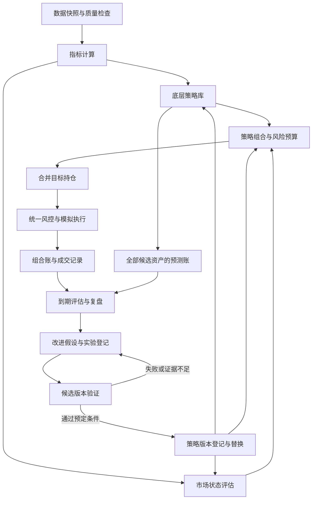

# quantmp：策略研究、组合运行与持续改进设计

2026-11-12 最新补充：历史研究按日自动推进「验证 → 复盘 → 修正 → 下一天」，不再等待现实每日才能研发。有限候选的每日版本调整已实现并实跑，结果与限制见 [逐日复盘记录](daily-walkforward-20261112.md)；111 项测试及三种成本场景审计通过，尚未证明改进优势。下面保留设计背景及早期阶段状态。

> 整理日期：2026-11-09；方向更新：2026-11-10。
> 状态：阶段 A 到 E 首版及 F 工程首版已交付，包含冻结、状态恢复和独立审计；实际仍亏损，真正冻结后新增样本及盈利确认尚待积累。
> 用途：作为后续开发和新对话的入口，区分已经明确的方向、待验证的假设和实际完成的工作。

2026-11-12 实际进展见 [继续验证记录](validation-20261112.md)：全套 103 项测试、13 个统一起点／预算及成本场景通过审计；已有少量冻结后新增数据，独立盈利确认仍待积累。下文保留原始设计和各阶段背景。

后续开发主线见 [历史时钟驱动的策略组合研究与模拟实盘](strategy-selection-replay.md)，当前交付与缺陷见 [实现记录](research-system-implementation.md)。本文件保留总体设计背景，实施顺序按最新约定推进。

## 1. 用户背景与项目目标

用户是计算机背景，正在使用 C++，希望利用量化交易改善家庭生活。当前研究市场是加密资产，已经整理资产定价、市场状态、风险和执行指标。

最终研究对象是依据当时信息挑选策略组合、持续积累扣除成本后收益的能力。底层策略、组合选择机制和策略库改进机制分别评价；持续盈利是待验证目标，不要求每个周期都盈利。

项目目标是建立一个可持续运行的研究闭环：

1. 获取并保存决策时可获得的数据。
2. 从指标提出可检验的策略假设。
3. 预测固定期限内的表现，筛选值得进一步考虑的资产。
4. 根据市场状态组合底层策略，形成目标持仓。
5. 在成本和风险约束下模拟执行。
6. 等预测结果成熟后，评估预测、组合和执行。
7. 提出改进假设，验证候选版本，再决定保留、替换或回退。

技术出身的成功案例可以提供动力，但不能作为具体策略有效、个人可复制收益或可持续盈利的证据。

## 2. 阅读入口与当前代码状态

| 文件 | 当前用途 |
| --- | --- |
| [strategy-selection-replay.md](strategy-selection-replay.md) | 最新确认的核心目标、历史时钟边界、研究与运行循环及验收标准 |
| [research-system-implementation.md](research-system-implementation.md) | 静态原型交付、BTC/SOL 数据接入及已知问题 |
| [asset-pricing-indicators.md](asset-pricing-indicators.md) | 指标分类、口径限制、最小研究指标集及元数据模板 |
| [quant.md](quant.md) | 交易优势、成本、数据时间、过拟合、执行可靠性和风险问题 |
| [quant2claude.md](quant2claude.md) | 已存在的讨论资料，后续按需参考 |
| [../README.md](../README.md) | 已有跨交易所现货价差监控工具的使用说明 |
| [../arbitrage.py](../arbitrage.py) | 公开 REST 盘口获取、按深度估算价差、成本计算和 SQLite 记录 |
| [../test_arbitrage.py](../test_arbitrage.py) | 已有价差监控工具的单元测试 |

截至 2026-11-10 的工程状态：

- 项目目录为 `D:\work\quantmp`；执行环境为 PowerShell，已检测到 Python 3.14.3。
- 当前代码以 Python 标准库实现。用户熟悉 C++，但尚未决定新系统全部使用 C++。
- 已有只读价差监控、独立影子账、连续组合、成熟反馈状态选择器、有限候选研究／确认／替换流程、SQLite 记录及 BTC/SOL 下载器。研究只用当时可见价格和成熟反馈，尚无开放式代码生成或不受限候选搜索。
- 已有配置文件和 `arbitrage.sqlite3`。后续实现应保留这些文件及现有功能。
- 项目已初始化 Git，远端为 `git@github.com:pan402945786/quantmp.git`，使用 `main` 分支；每次提交和同步状态以实际命令结果为准。
- 根目录 `AGENTS.md` 记录后续开发入口；继续开发前读取并检查工作区约定与用户改动。
- 阶段 A 到 E 完成连续研究回放首版，F 工程首版增加冻结源码／协议、真实状态检查点、追加恢复、修订链及独立报告。99 项测试通过；BTC/SOL 分段恢复与完整回放逐项一致，但两个候选仍失败，实际仍为 -22.39%。当前没有冻结后新行，不宣称独立盈利确认完成，范围见实现记录。

## 3. 已明确的设计方向

### 3.1 判断策略是否有效的依据

- 指标是输入，不直接等于交易优势。
- 估值偏低不代表马上上涨；绝对收益、相对收益与风险承担需要分别评价。
- 编程能力用于数据质量、实验复现和系统可靠性；策略优势仍需证据。
- 以扣除成本后的样本外结果评价策略，同时观察回撤、换手、集中度与成本敏感性。
- 系统允许输出观察、不买和保留现金。
- 第一阶段使用离线研究和模拟组合，不接入真实下单。

### 3.2 策略库与市场状态

建立一个共享数据、风控和执行层的策略库。市场状态模块调整策略预算，而不是为每种行情复制一套独立系统。

底层策略先独立运行、独立记账；随后比较固定组合与动态组合。不能预设动态分配一定更好。

### 3.3 持续改进的含义

系统可以自动提出、执行和汇总实验。现行策略的替换则由预先约定的证据条件控制。

研究流程与运行流程分开：

```text
研究：假设 → 实验 → 验证 → 冻结候选版本 → 新数据确认
运行：数据 → 策略信号 → 状态与预算分配 → 风控 → 模拟执行 → 记录
```

数据积累不足或没有更优候选时，保持现行版本是正常结果。

## 4. 总体架构



数据、指标、底层策略、状态评估和组合规则分别版本化。一次实验尽量只改变一个主要因素。

## 5. 预测目标与资产范围

### 5.1 三个不同的问题

| 问题 | 输出 | 负责模块 |
| --- | --- | --- |
| 哪些币可能表现更好？ | 固定期限内的相对排名或收益预测 | 策略与预测 |
| 是否值得承担风险？ | 买入、持有、观察或退出 | 组合决策 |
| 应当配置多少？ | 约束后的目标仓位 | 风险预算 |

排名第一不自动代表值得买。预测分数也不自动等于上涨概率；若输出概率，需要另外评估其校准情况。

### 5.2 研究范围按数据条件决定

- 基本面历史可靠、价值捕获机制清晰的资产，可进入相应估值研究池。
- 仅有可靠行情数据的资产，可进入价格策略研究池。
- 业务类型、代币权利与价值来源差异较大的资产，不强行放入同一估值倍数排名。
- 不把缺少持有人现金流的资产一律判定为没有价值；其他估值机制需要单独研究。
- 历史资产池按当时信息构建，记录上币、下架、失败项目和机制变更。
- 无法取得可信退出价格或缺失关键记录时，应标记并报告限制，不能悄悄删除亏损资产。

### 5.3 尚未确定的实验参数

静态原型已有 Binance 现货 BTCUSDT、SOLUSDT 日线数据及示例配置。新的历史时钟实验仍需预先冻结模拟起点、预热长度、研究与调仓频率、训练和验证切分、预测期限、选择器、风险限额与成本假设；旧配置不是已验证的最优方案。

对话中的七天、二十八天及其他数字都只是示例，不是已经验证的参数。实施时需要冻结一个主要预测目标，限制试验数量，并记录全部尝试。

## 6. 数据与指标层

### 6.1 时间与可追溯性

至少区分事件时间、发布时间、采集时间和可用时间。回测只能使用决策时已可获得的版本。

每次研究保存：数据来源、口径、快照标识、内容摘要、配置及代码版本。数据修订另存版本，不覆盖历史预测所用输入。

数据校验覆盖重复记录、排序、时区、非有限数值、异常价格、缺失区间、供应量口径和单位一致性。缺失值处理不得引入未来信息。

### 6.2 指标职责

| 类别 | 候选指标 | 主要职责 |
| --- | --- | --- |
| 价格与相对表现 | 多周期收益、相对市场收益、历史 Beta | 趋势、相对强弱与偏离研究 |
| 基本面 | 使用量、用户费用、协议收入、持有人收益 | 经营变化与估值研究 |
| 供给 | 流通量、FDV、解锁与激励 | 稀释及供给压力研究 |
| 风险 | 波动、回撤、相关性 | 风险预算与集中度控制 |
| 可交易性 | 成交金额、价差、深度、滑点 | 交易资格与容量检查 |
| 衍生品状态 | 资金费率、OI、基差 | 后续检验增量信息，不意味着需要杠杆交易 |

协议收入、持有人收益、回购和销毁不能混为一谈。解锁量不直接等于卖出量。MVRV 等链上成本指标不直接等于内在价值。

## 7. 底层策略库

第一批候选策略如下。它们是研究假设，尚未证明有效。

| 策略 | 核心假设 | 重点失败条件 |
| --- | --- | --- |
| 简单趋势／动量 | 已形成的价格运动可能延续 | 成本侵蚀、震荡反复交易、反转损失 |
| 相对偏离回归 | 剔除市场影响后的异常偏离可能回归 | 偏离来自持续恶化、关系不稳定或缺乏交易能力 |
| 估值与经营改善 | 相对便宜且真实经营改善可能带来额外信息 | 价值捕获失真、补贴驱动、供给稀释、无增量预测能力 |

单个策略需要声明：

```text
名称、版本和经济假设
适用资产池、数据要求、指标版本
预测期限、信号产生时间、有效期
入场、持有、退出和再平衡规则
信号分数、收益预测或目标仓位的单位
成本假设、风险暴露和基准
缺失数据处理、失效条件和实验历史
```

初期先采用可解释规则和简单统计方法。复杂模型作为候选版本，与简单基准竞争。

### 7.1 基本面实验示例

核心问题：同类资产中，相对便宜且经营改善的资产，是否优于仅便宜或仅改善的资产？

| 分组 | 估值 | 经营变化 |
| --- | --- | --- |
| A | 相对便宜 | 未改善 |
| B | 相对便宜 | 改善 |
| C | 不便宜 | 改善 |
| D | 不便宜 | 未改善 |

重点比较 B 相对 A、C 的增量，检查规模、流动性、市场暴露和过去涨幅等差异。样本不足时不强行分组。

经营改善与事先固定的历史基线比较，同时检查补贴和计价变化。该基线称为模型预期，不冒充市场共识。

## 8. 市场状态与组合分配

### 8.1 状态先使用可观察维度

- 方向与趋势强度：市场收益及持续程度。
- 波动与压力：历史波动、近期回撤。
- 流动性：价差、深度及目标订单滑点。
- 广度与集中度：上涨资产比例和收益集中程度。

第一版无需立即引入复杂隐状态模型。状态必须实时生成并留存；后续使用状态模型时，防止将利用未来数据的平滑状态当作当时已知状态。

### 8.2 预算分配

- 各策略持续产生影子信号，组合层决定采用程度。
- 以固定组合为基准，检验动态组合的增量。
- 分配考虑策略证据、共同风险、成本和预算调整幅度。
- 不直接根据近期输赢追涨杀跌式调权。
- 所有策略目标先合并，再与实际持仓比较，形成净订单。
- 对同币、同类资产和相似风险暴露统一限额。
- 允许现金，不要求每期买入或保持满仓。

策略预算与资产仓位之间的转换必须明确单位。动态分配器本身也是待验证模型，不能默认优于固定权重。

## 9. 回测、模拟与两本账

### 9.1 交易时间与成本

研究协议必须明确：何时数据可用、何时生成信号、最早何时可成交、采用何种成交价。

例如使用日线收盘形成信号时，不能未经说明就按该收盘价成交。第一版选择一个简单、明确、有延迟的成交约定，并对更差成交成本进行敏感性分析。

成本包括手续费、价差和滑点。首轮采用现货、无杠杆模型；盘口冲击、部分成交、最小交易单位及容量逐步补充。尚未模拟的限制在报告中列明。

不能把缺失价格默认为持仓消失或无损退出。应明确估值、冻结交易和数据质量失效的处理方式。

### 9.2 预测账

记录全部评估资产，包括没有买入的资产：

```text
prediction_id、决策时间、数据快照
策略版本、指标版本、状态和分配器版本
资产、预测期限、分数／预测收益及其含义
当时资格、风险标记和决策理由
目标到期时间、标签成熟状态、实际后续市场收益
```

历史预测不可覆盖；到期标签追加记录。未持有资产可观察后续市场表现，但其假设成交收益仍是模拟估计。

### 9.3 组合账

记录现金、持仓、目标仓位、订单、成交、成本、权益和风险。分别评价：

- 预测质量：排名、方向或收益预测是否有信息。
- 组合质量：净收益、回撤、波动、集中度和换手。
- 执行质量：计划与模拟成交差异、成本及不可成交情况。
- 数据质量：缺失、延迟和口径异常。

初期使用明确的基准，例如合格资产池等权、简单动量和现金。BTC 可作为附加市场参照，不能代替同资产池的公平比较。

## 10. 实验与自我改进

### 10.1 从观察到实验

每次复盘区分信号问题、市场暴露、组合问题、执行问题、数据问题及证据不足。

实验登记字段：

```text
experiment_id、父策略版本、创建时间
观察到的问题、可证伪假设
本次改变的主要因素
数据范围、开发／验证／确认区间
主要指标、成功条件、失败条件
预算与停止条件
全部结果、失败原因、保留／放弃决定
```

示例：毛收益尚可但滑点偏高 → 假设流动性筛选过宽 → 仅调整该筛选 → 同时检查净收益和机会损失。

### 10.2 验证纪律

- 按时间划分开发、验证和最终确认数据，不随机打乱时间记录。
- 预测标签必须成熟后才能用于训练或完整评价。
- 训练标签区间不能跨入验证／测试期；按预测期限处理边界重叠。
- 记录全部参数尝试和失败实验，限制搜索范围。
- 被反复用于修改方案的数据不再算独立测试。
- 新版本冻结后，以后续新数据做影子确认；同一批结果不能反复用于修改并宣称独立验证。
- 区分资产数与独立证据量，考虑同日资产相关性和重叠持有期。

### 10.3 候选版本替换

```text
假设登记 → 历史实验 → 候选冻结 → 影子运行
        → 达到预定标准则替换 → 保留旧版本以便回退
        → 失败或证据不足则继续观察／放弃
```

替换条件应兼顾净收益、回撤、风险暴露、成本敏感性和收益集中度。具体门槛尚未确定，应在观察实验结果前制定。

底层策略、状态模型和分配规则分别比较。报告同时保留单策略、固定组合、动态组合结果。

### 10.4 大模型的职责

可用于整理证据、检查异常、生成复盘草案、提出实验和辅助开发。

大模型解释属于待验证假设；不能直接据此调权、修改风险上限或绕过评估条件。外部文章和社交内容按不可信输入处理。

## 11. 开源项目参考与选型原则

以下是对话中确认值得参考的公开项目。当前判断基于官方文档和仓库描述，尚未本地安装、运行或验证依赖兼容性，不代表已经拿到机构完整盈利系统。

| 项目 | 优先借鉴 | 本项目仍需核实 |
| --- | --- | --- |
| [Microsoft Qlib](https://github.com/microsoft/qlib) | 数据、训练、回测、评估与实验工作流 | 加密数据适配、时间语义、依赖与当前 Python 兼容性 |
| [Microsoft RD-Agent](https://github.com/microsoft/RD-Agent) | 假设、实现、评估、反馈的自动研究循环 | 实验预算、验证隔离、模型调用依赖和替换机制 |
| [QuantConnect LEAN](https://github.com/QuantConnect/Lean) | 资产池、信号、组合、风险、执行的接口边界 | 目标市场支持、成本模型和接入工作量 |
| [NautilusTrader](https://github.com/nautechsystems/nautilus_trader) | 事件驱动回放、模拟与运行状态管理 | 交易场所适配、运行环境和成交模型 |
| [Goldman Sachs GS Quant](https://github.com/goldmansachs/gs-quant) | 金融对象与风险表达 | 功能适配度、外部服务依赖，当前作为次要参考 |

初步优先级：研究流程参考 Qlib、RD-Agent；策略组合接口参考 LEAN；执行候选再比较 LEAN 与 NautilusTrader。

先用同一份数据、同一简单策略和成本假设做小实验，再选择直接采用、局部复用或只借鉴设计。第一阶段只选一个研究主框架和一个回测执行方案，避免同时集成多套框架。

用户熟悉 C++。可将其用于采集、回放和经测量确有需要的系统模块；研究侧选便于实验的工具。现有 Python 代码是起点，不预设需要全面重写。

## 12. 分阶段实施计划

2026-11-10 起采用 [最新开发约定第 10 节](strategy-selection-replay.md#10-后续开发顺序) 的阶段 A 到 F，替代原先阶段 0 到 4 的推进顺序。已有文档中的“阶段 1”名称保留，用于指代静态原型的历史交付。

| 阶段 | 主要交付 |
| --- | --- |
| A（已完成） | 修复负现金、费用预留、扣费后仓位、初始权益与等权／现金基准 |
| B（已完成） | 历史时钟、只读数据视图、可用时间、延迟订单和越界拒绝 |
| C（已完成） | 独立影子账、固定策略组合、合并净订单及连续资金账 |
| D（已完成首版） | 当时数据内训练与验证、冻结和生效管理、动态组合选择器 |
| E（已完成受限首版） | 假设和失败登记、有限候选计划、尝试预算、影子确认和父位置替换 |
| F（工程首版已交付） | 固定协议／源码、检查点恢复、只追加数据和审计报告；真正新增样本仍待积累 |

后续真实交易另行讨论，本计划不包含真实下单实现。

## 13. 第一阶段验收与必要测试

这属于交易研究核心逻辑，测试应覆盖实质风险：

- 可用时间之后的数据不得影响此前预测；修改未来输入不改变过去信号。
- 成交时间严格遵守约定，不能偷用信号产生前不可成交的价格。
- 手续费和滑点扣减正确，买卖资金守恒；现金不足不产生隐含借款。
- 仓位、集中度和总预算约束有效。
- 标签成熟前不进入训练或完整评价。
- 缺失价格、异常数据、下架和无成交能力有明确处理。
- 相同数据、配置及版本可复现。
- 对照实验使用一致成本与风险约束；变更版本能追溯。
- 新增实现后运行与变更相关的检查，并验证既有价差工具的测试仍通过。

文档整理本身不需要新增程序测试。

## 14. 当前交接点与续接提示

截至 2026-11-10，连续研究回放和冻结恢复工程首版已交付。资金、标签、版本和研究状态可从检查点恢复，并由独立账务报告核对；但两个 BTC/SOL 候选均验证失败，未证明选择或改进优势。补回历史数据不成为独立确认，真正冻结后新增样本仍待积累。

后续读取根目录 `AGENTS.md`、[最新开发约定](strategy-selection-replay.md) 和 [实现记录](research-system-implementation.md)，核实工作区和已冻结运行。优先保留旧源码／协议及检查点，积累新行，并完善风险匹配、成本压力和数据发布时间追溯。改变规则时另起实验，保留两次候选失败及亏损，不从已看过的结果反推最优参数。

关键实验参数应在正式运行前冻结；尚未确定的起点、周期和阈值保持显式待定，不从已看过的结果中挑选后伪称事前决定。可以自主处理已授权的可逆工程工作，继续同步文档与 GitHub。

可直接复制下面的提示：

```text
继续 quantmp 开发，先读取 AGENTS.md、docs/strategy-selection-replay.md、
docs/research-system-implementation.md，检查工作区现状。
目标是检验当时信息下挑选策略组合以持续积累净收益的能力。
阶段 A 到 E 首版及 F 工程首版已交付；真实冻结后新数据仍待积累。
保留旧运行与源码归档，继续完善风险匹配、成本压力及发布时间／修订追溯。
研究与训练只能访问当时可用的数据和成熟反馈；候选冻结并生效后才能参与运行。
保留连续资金账、全部尝试、失败记录和版本切换成本。
同步文档与 GitHub，如实记录已经完成、待实现和已知问题。
```
